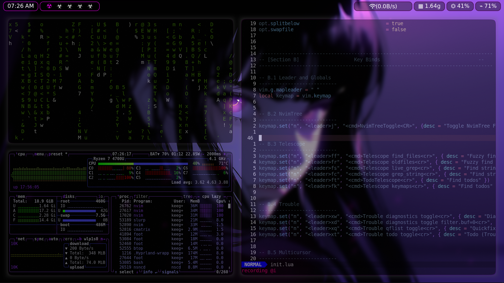

# Hypr-Nix

Minimal, fast NixOS + Hyprland dotfiles managed as a flake.

## Sample Setup



## Stack

- **WM**: Hyprland
- **Bar**: Waybar
- **Launcher**: Wofi
- **Terminal**: Kitty
- **Editor**: Neovim
- **Shell prompt**: Starship
- **Display manager**: SDDM (sddm-astronaut theme)
- **Notifications**: Hypridle / Hyprlock

## Structure

```
dotfiles/
├── flake.nix                        # Flake inputs + nixosConfigurations.eyelady_core
├── nixos/
│   ├── configuration.nix            # Main system config, imports all modules
│   ├── hardware-configuration.nix   # Auto-generated hardware config
│   ├── packages/
│   │   └── default.nix              # Custom derivations (keybind-helper, mpv-play, etc.)
│   └── nix_modules/
│       ├── desktop_environment.nix  # Hyprland, SDDM, desktop packages
│       ├── gaming.nix               # Steam, Gamescope, gaming deps
│       ├── graphics.nix             # NVIDIA prime offload config
│       ├── sound.nix                # Pipewire, audio packages
│       ├── networking.nix           # NetworkManager, SSH, hosts
│       ├── bluetooth.nix            # Bluetooth config
│       ├── services.nix             # System services (gvfs, printing, etc.)
│       └── environment_variables.nix # Wayland session variables
└── .config/                         # User configs (hypr, nvim, waybar, kitty, etc.)
```

## Rebuild

```bash
sudo nixos-rebuild switch --flake /home/keegan/dotfiles#eyelady_core
```
